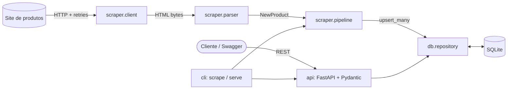

# 🛒 Product Data Pipeline

**Pipeline ETL de web scraping + API REST para dados de produtos.**
Coleta um catálogo na web, normaliza e persiste em SQLite e expõe tudo por uma API documentada.


[](https://github.com/SimoesBia/product-data-pipeline/actions/workflows/ci.yml)


## 📌 O problema

Dados de produtos ficam espalhados em páginas HTML sem API. Para usá-los (análises, dashboards, outros serviços), é preciso extrair, limpar, guardar de forma consistente e servir por uma interface estável.

## 💡 A solução

Um único projeto com duas partes que compartilham o mesmo núcleo:

1. **Pipeline ETL** — percorre toda a paginação do catálogo, interpreta cada produto (nome, preço, moeda, avaliação, disponibilidade, URL) e grava no banco com *upsert*, de modo que rodar de novo atualiza preços em vez de duplicar registros.
2. **API REST (FastAPI)** — consulta com filtros, ordenação e paginação, CRUD completo, estatísticas do catálogo e documentação interativa (Swagger) gerada automaticamente.

> Fonte de dados do exemplo: [books.toscrape.com](http://books.toscrape.com/), um site sandbox criado para praticar scraping.

## ✨ Destaques técnicos

- **Idempotência:** `INSERT ... ON CONFLICT(url) DO UPDATE` — o pipeline pode rodar quantas vezes quiser.
- **Resiliência:** timeout, *retries* com backoff exponencial, commit por página (falha no meio não perde o que já foi salvo) e produtos malformados são pulados e logados, sem derrubar a página.
- **Dinheiro em centavos (`INTEGER`):** evita erros de arredondamento de ponto flutuante.
- **Segurança:** queries parametrizadas, *whitelist* para campos de ordenação, escape de `LIKE`, validação estrita com Pydantic (`extra="forbid"`).
- **Camadas separadas:** parser puro (sem rede), repositório (SQL), pipeline (orquestração), API (HTTP) — cada uma testável isoladamente.
- **Configuração 12-factor:** tudo por variáveis de ambiente / `.env`.
- **Qualidade:** testes automatizados, lint com Ruff, CI no GitHub Actions e Dockerfile.

## 🏗️ Arquitetura



```
.
├── src/product_pipeline/
│   ├── cli.py                # comandos: scrape | serve
│   ├── config.py             # Settings (env vars + .env)
│   ├── models.py             # modelos de domínio e conversão de moeda
│   ├── db/
│   │   ├── connection.py     # conexão, schema, transações
│   │   └── repository.py     # CRUD, busca, upsert, estatísticas
│   ├── scraper/
│   │   ├── client.py         # HTTP com retries/timeout
│   │   ├── parser.py         # HTML -> produtos (função pura)
│   │   └── pipeline.py       # Extract -> Transform -> Load
│   └── api/
│       ├── app.py            # application factory + handlers de erro
│       ├── schemas.py        # contratos de entrada/saída (Pydantic)
│       ├── deps.py           # injeção de dependência
│       └── routes/           # health.py, products.py
├── tests/                    # parser, repositório, pipeline, config, API
├── .github/workflows/ci.yml  # lint + testes
├── Dockerfile
└── pyproject.toml
```

## 🔌 Endpoints

Documentação interativa em **`/docs`** (Swagger) e **`/redoc`**.

| Método | Rota | Descrição |
|--------|------|-----------|
| `GET` | `/health` | Verifica API e banco (`200` ou `503`) |
| `GET` | `/api/v1/products` | Lista com filtros, ordenação e paginação |
| `GET` | `/api/v1/products/stats` | Total, em estoque, preço médio/mín./máx., avaliação média |
| `GET` | `/api/v1/products/{id}` | Detalhe de um produto (`404` se não existir) |
| `POST` | `/api/v1/products` | Cria produto (`201`; `409` se a URL já existir; `422` se inválido) |
| `PATCH` | `/api/v1/products/{id}` | Atualização parcial |
| `DELETE` | `/api/v1/products/{id}` | Remove (`204`) |

**Parâmetros de listagem:** `search`, `min_price`, `max_price`, `min_rating` (1–5), `in_stock`, `sort` (`id`, `name`, `price`, `rating`, `created_at`), `order` (`asc`/`desc`), `limit` (1–100, padrão 20), `offset`.

Exemplo:

```bash
curl "http://127.0.0.1:8000/api/v1/products?min_rating=4&sort=price&order=asc&limit=5"
```

```json
{
  "items": [
    {
      "id": 7,
      "name": "Sharp Objects",
      "price": 47.82,
      "currency": "GBP",
      "rating": 4,
      "in_stock": true,
      "url": "http://books.toscrape.com/catalogue/sharp-objects_997/index.html",
      "source": "books.toscrape.com",
      "created_at": "2026-01-01T12:00:00Z",
      "updated_at": "2026-01-01T12:00:00Z"
    }
  ],
  "total": 1,
  "limit": 5,
  "offset": 0
}
```

## 🚀 Como instalar e executar

**Pré-requisitos:** Python 3.10+ e Git.

```bash
# 1. Clone o repositório
git clone https://github.com/SimoesBia/product-data-pipeline.git
cd product-data-pipeline

# 2. Crie e ative o ambiente virtual
python -m venv .venv
source .venv/bin/activate        # Windows: .venv\Scripts\activate

# 3. Instale as dependências
pip install -r requirements-dev.txt
pip install -e .

# 4. (Opcional) configure o ambiente
cp .env.example .env

# 5. Rode o pipeline de scraping (popula data/products.db)
product-pipeline scrape --max-pages 5

# 6. Suba a API
product-pipeline serve
```

Abra **http://127.0.0.1:8000/docs**.

### 🐳 Com Docker

```bash
docker build -t product-data-pipeline .
docker run --rm -v pipeline-data:/data product-data-pipeline product-pipeline scrape --max-pages 5
docker run --rm -p 8000:8000 -v pipeline-data:/data product-data-pipeline
```

### ⚙️ Configuração

| Variável | Padrão | Descrição |
|----------|--------|-----------|
| `DATABASE_PATH` | `data/products.db` | Arquivo SQLite |
| `SCRAPER_BASE_URL` | `http://books.toscrape.com/` | Página inicial do catálogo |
| `SCRAPER_MAX_PAGES` | `50` | Máximo de páginas (`0` = todas) |
| `SCRAPER_DELAY_SECONDS` | `0.5` | Pausa entre páginas |
| `SCRAPER_TIMEOUT_SECONDS` | `10` | Timeout por requisição |
| `API_HOST` / `API_PORT` | `127.0.0.1` / `8000` | Endereço da API |
| `LOG_LEVEL` | `INFO` | Nível de log |

## 🧪 Testes e qualidade

```bash
pytest -v          # testes automatizados
ruff check .       # lint
```

Os testes do scraper usam páginas HTML salvas (*fixtures*), então rodam offline e de forma determinística. O pipeline é testado com um *fetcher* falso injetado, cobrindo paginação, idempotência, limite de páginas, *delay* e falha no meio da execução.

## 🔭 Melhorias futuras

- [ ] Migrar para **PostgreSQL** com **SQLAlchemy 2 + Alembic** (migrações versionadas)
- [ ] **Histórico de preços** (tabela de snapshots) para analisar variação ao longo do tempo
- [ ] **Agendamento** do pipeline (cron, GitHub Actions ou Airflow/Prefect)
- [ ] Scraping **assíncrono** (`httpx` + `asyncio`) e respeito a `robots.txt`
- [ ] Coletar **categoria e descrição** pelas páginas de detalhe
- [ ] **Autenticação** (API key/JWT) e *rate limiting* nos endpoints de escrita
- [ ] **Validação de qualidade de dados** (pandera / Great Expectations) antes do *load*
- [ ] **Observabilidade:** logs estruturados em JSON e métricas Prometheus
- [ ] Paginação por *cursor* e cache com ETag
- [ ] Deploy contínuo (CD) em Render/Fly.io/Cloud Run

## 📄 Licença

Distribuído sob a licença MIT. Veja [`LICENSE`](LICENSE).

---

Feito por **Bruna Simões** · [GitHub](https://github.com/SimoesBia)
